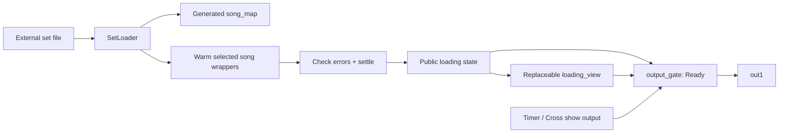

# Setlist preparation

The master prepares a selected set before showing any visual. `SetLoader` owns
preparation and publishes state; `loading_view` owns its appearance. The
[programme view](ProgrammeStartup.md) shares the connection screen's title,
footer, marks and noise panel and can be replaced independently.

## Select the set

Edit [setlist.json](setlist.json). **Set File** on the master points to it,
relative to the open TOE folder. Component paths are relative to the JSON file.

```json
{
  "visuals": {
    "resignation_live": {
      "name": "resignation",
      "tox": "tracks/resignation/mapped.tox",
      "preview": "tracks/resignation/preview.png"
    }
  },
  "projects": ["resignation_live"]
}
```

The `visuals` registry maps exact Bitwig names to unique component names and
external mapped TOX files. `projects` is the nonempty, duplicate-free warmup
selection. Optional `requires: {"raytk": "0.46"}` declares a shared toolkit.
The current four-song set has no shared-toolkit requirement: its RayTK scenes
render from their self-contained mapped exports. The main RayTK editing library
is omitted from both master TOEs and belongs in individual scene authoring projects.
Paths, names, project selection and dependencies are validated before replacing
residents. The embedded `setlist` DAT is a loaded snapshot for inspection;
`song_map` is generated. Edit the JSON file, not those generated DATs.

Startup and **Load Set** read this configuration, create a host for each
registered component, load its TOX, validate its public contract, then warm the
selected song components. The built-in connection screen is not a warmup item. All registered components
remain resident; unselected ones are imported but not proactively warmed.
No file loading occurs during project switches. Load Set gates show output,
resets routing and stops song input while components are replaced. Failures keep
Ready off and show a specific error; fix the source and retry Load Set.

All wrappers retain **Allow Cooking on**. Normal routing controls TOP demand.
Personal title metadata is optional and does not affect preparation or display.
Optional `preview` paths are relative to the JSON file. The loading presentation
uses them for its right-hand image; they do not affect validation or readiness.

## Preparation and readiness

Wrappers are prepared sequentially. For each wrapper, the loader renders any
declared gated TOP branches, then demands its `out1` for 60 native frames. It
checks recursive operator and script errors, then moves to the next wrapper.
After every wrapper completes, it settles for ten frames and checks errors
again before setting **Ready**. These callbacks are finite startup work.

The nested reusable visual can declare branches that its final output might
not exercise in the saved state. Add an optional `warmup_tops` Table DAT inside
that visual, with one `top` column:

```text
top
Scanner/surface_mask/shaderExecutor/render_glsl
Scanner/composite
```

Rows are relative TOP paths within that visual; absolute paths, missing operators
and paths outside the visual fail. This declaration belongs to the visual, so
the loader does not need private effect-path knowledge.

Teachers Pet uses blocking shader compilation in the current fixture. The
60-frame warm period is not a general completion signal for future threaded
compilation, movie decoding or other asynchronous resources; those need explicit
readiness checks before the set can be marked Ready.



## Presentation contract

`loading_view` has one **State** OP parameter pointing to the publisher, normally
its parent master. Presentation reads only these public parameters:

| Parameter | Meaning |
| --- | --- |
| `Ready` | Preparation succeeded; show output may be presented. |
| `Loading` | Preparation is in progress. |
| `Loadcount` | Completed selected song wrappers. |
| `Loadtotal` | Planned selected song wrappers. |
| `Loadvisual` | Wrapper currently being prepared; empty while settling. |
| `Loadstatus` | Preparation phase or explicit error message. |

Read those parameters to build a new skin and return an `out1` TOP at the host
resolution. `loading_readout.py` formats the programme presentation independently of the
loader. `SetLoader` does not access Text TOPs, fonts or presentation operators.
The master's `output_gate` selects the view while Ready is false and show output
when Ready is true. Progress counts completed wrappers, not estimated seconds.

## Routing while loading

Only the latest project request is retained until readiness. With no queued
request, unavailable startup selects the screensaver. A connected source is
queried for the selected project's audio-engine state; its visual is accepted
only when that engine is active and both observers agree on the project name.
Selecting an inactive tab holds the accepted visual, while song input may drop.
The performance master has no mock project selector.
After loading, the empty-project connection screen appears by a hard cut.
Normal song requests retain their two-second crossfades.

A registered visual outside the warmed set can still be selected.
The fade reports **not preloaded**; first-use shader compilation or other work
may delay it. Each such transition appends an `unwarmed_fallback` event with UTC
time, project name and visual name to `live_bw_events.jsonl` beside the open
TOE. No extra proactive warmup or cooking-flag change is performed. A log write
failure remains visible as **EVENT LOG ERROR** without blocking the visual cue.
Missing mappings and broken visuals retain their visible errors.

**Reset to Black** during loading lets preparation finish but holds black until
a new project request.
Loader failure leaves Ready and Loading false and shows the error view. Correct
the setlist/component error and pulse **Load Set** to retry.

## Verification

After changing the registry, reopen the saved master or use Load Set. Verify
all selected items reach Ready, the preview paths resolve, and the output is
1920×1080. The heartbeat reports loading progress and readiness to `vs_set`.
Song routing and audio fidelity still require a connected Bitwig rehearsal.
